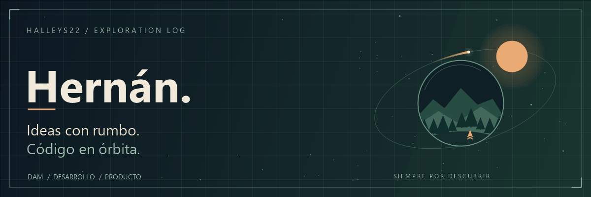

<picture>
  <source media="(prefers-reduced-motion: reduce)" srcset="./assets/banner-static.png">
  
</picture>

  <b>Estudiante de DAM � Desarrollo de aplicaciones � Curiosidad por el producto</b> 
  C�ceres, Espa�a

### Hola, soy Hern�n ??

Estudio **2.� de Desarrollo de Aplicaciones Multiplataforma en Cesur**. Me gusta imaginar c�mo deber�a funcionar una aplicaci�n y convertir esas ideas en proyectos con los que seguir aprendiendo.

Me interesan especialmente el **dise�o de producto**, las interfaces claras y la tecnolog�a que resuelve problemas cotidianos. Aqu� comparto proyectos personales, trabajos de clase y peque�os experimentos.

### Mi mapa de proyectos

| Proyecto | Qu� encontrar�s | Tecnolog�as |
| :--- | :--- | :--- |
| **[01 � OFICERCA](https://github.com/Halleys22/oficerca)** | Prototipo personal para conectar clientes con profesionales de fontaner�a. Exploraci�n de producto, solicitudes, presupuestos y agenda con datos de demostraci�n. | Next.js � React � TypeScript � SQLite |
| **[02 � Alquiler de patinetes](https://github.com/Halleys22/alquiler-patinetes-java)** | Aplicaci�n acad�mica de escritorio para registrar, consultar y eliminar alquileres. | Java � JavaFX � JDBC � MySQL |
| **[03 � To Do List](https://github.com/Halleys22/to-do-list-flutter)** | Aplicaci�n acad�mica de tareas con categor�as, filtros, modo oscuro y almacenamiento local. | Flutter � Dart |
| **[04 � Laboratorio DNS](https://github.com/Halleys22/kali-dns-lab)** | Pr�ctica de DNS autoritativo y bloqueo con RPZ, con un script de comprobaci�n. | Linux � BIND 9 � Bash |

### Tecnolog�as que estoy explorando

Trabajo con estas tecnolog�as en mis proyectos y ejercicios. Sigo reforzando fundamentos, practicando y documentando lo que aprendo.

  
<b>Una se�al desde fuera del editor ??</b>

Los videojuegos, la m�sica y el caf� tambi�n tienen su �rbita por aqu�. **Outer Wilds** es uno de mis favoritos: explorar, hacerse preguntas y descubrir c�mo encajan las piezas. Un poco de esa curiosidad se ha colado en este perfil.

---

HALLEYS22 � Siempre queda algo por descubrir.

